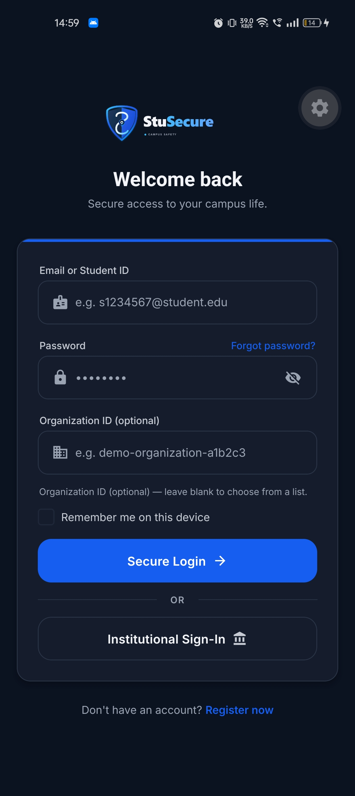
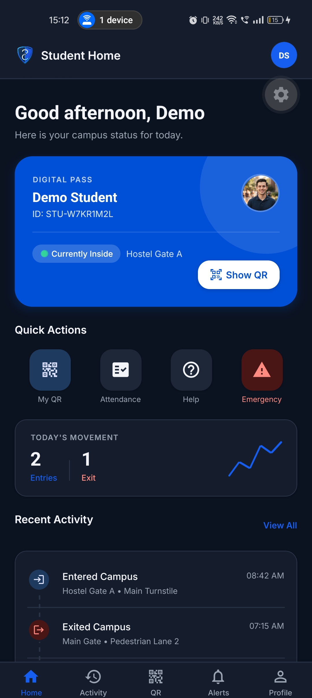
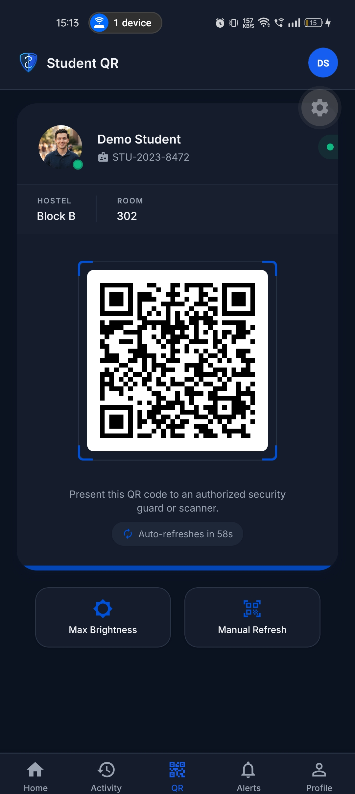
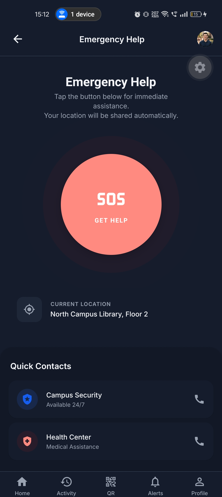
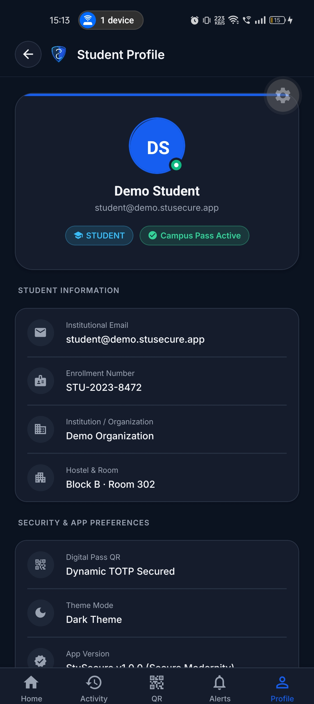
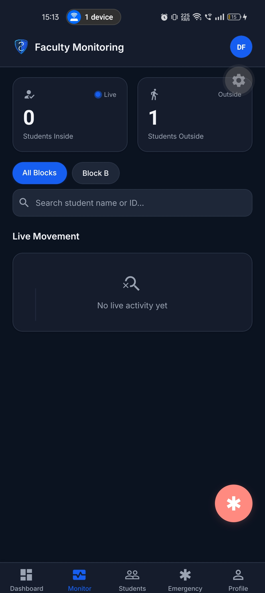
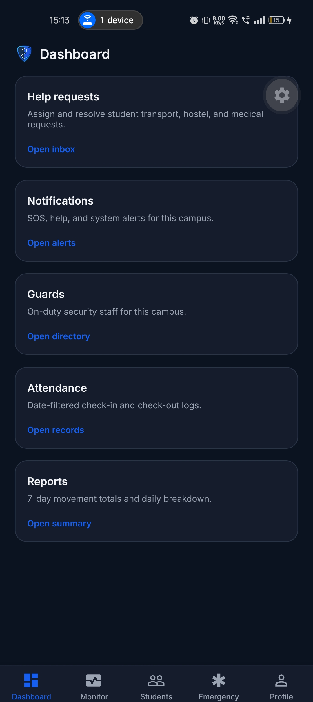
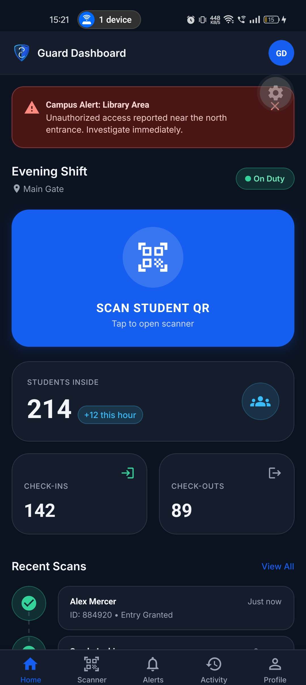
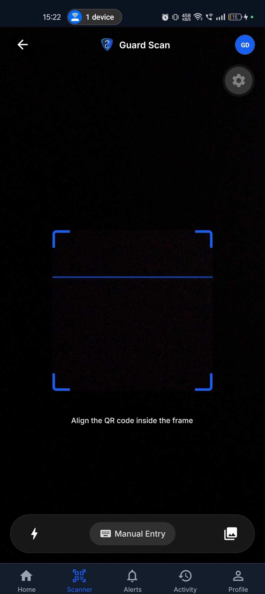
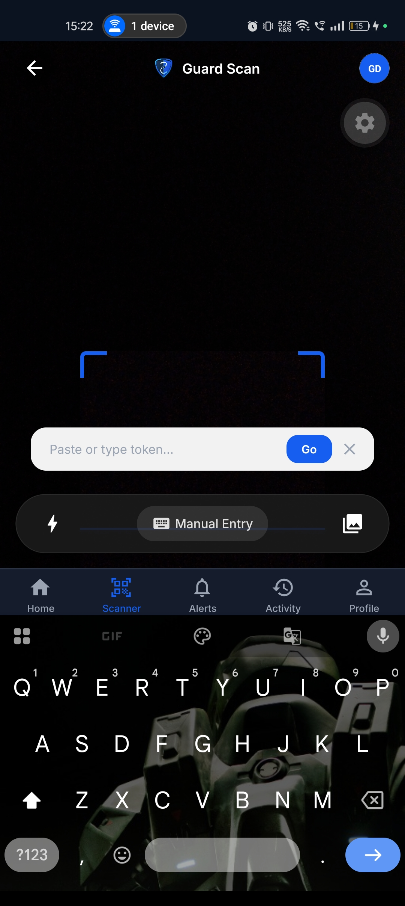

<div align="center">

# 🛡️ StuSecure Mobile Client

**Cross-Platform React Native & Expo Application for Students, Guards, and Faculty**

[](https://reactnative.dev)
[](https://expo.dev)
[](https://www.typescriptlang.org)
[]()
[]()

[Master README](../README.md) • [Features](#features) • [Mobile Personas](#mobile-personas) • [Tech Stack](#tech-stack) • [Getting Started](#getting-started) • [Branding & Assets](#branding--assets) • [Screenshots](#screenshots)

</div>

---

The **StuSecure Mobile Client** is the mobile-first operational surface of the StuSecure campus security platform, built with **React Native 0.86**, **Expo SDK 57**, and **Expo Router 57**. It provides role-tailored workflows for Students, Security Guards, and Faculty Wardens.

---

## Features

### 🎓 Student Workspace
- Dynamic rotating TOTP QR access pass with live countdown timer
- Real-time clearance status badge (Granted, Curfew Warning, Revoked)
- Hostel block, room number, and warden credentials
- Outpass / leave request creation and historical log
- Personal gate movement audit history
- High-priority instant SOS emergency beacon with live guard dispatch
- Accessible Light / Dark theme switching with modern profile UI

### 👮 Security Guard Workspace
- High-velocity camera QR scanner with cryptographic HMAC validation
- Instant student profile lookup (photo, enrollment, room, clearance status)
- One-tap gate entry and exit logging
- Real-time emergency distress alerts with sound, vibration, and location details
- High-contrast guard dashboard optimized for outdoor visibility
- Active shift tracking and checkpoint station management

### 👨‍🏫 Faculty & Warden Workspace
- Real-time student hostel occupancy directory
- Outpass / leave application review, approval, and rejection
- Curfew violation monitoring and movement audit logs
- Incident response tracking and resolution

---

## Mobile Personas

| Role | Default Tab Route | Primary Capabilities |
|---|---|---|
| **Student** | `app/(student)/index.tsx` | Dynamic QR Pass, History, Outpass, Profile, SOS Beacon |
| **Security Guard** | `app/(guard)/index.tsx` | High-Speed QR Scanner, Shift Stats, Movements, Alerts |
| **Faculty / Warden** | `app/(faculty)/index.tsx` | Live Monitoring, Outpass Approvals, Student Directory |

---

## Tech Stack

- **Framework:** React Native 0.86.3 with Expo 57.0.27
- **Routing:** Expo Router 57 (file-based navigation with typed routes)
- **Language:** TypeScript 6.0.3
- **State Management:** Zustand 5.0 (client state) & TanStack React Query 5.102 (server caching)
- **Camera & Scanner:** Expo Camera 57
- **Animation & Haptics:** React Native Reanimated 4.5 & Expo Haptics
- **QR Engine:** react-native-qrcode-svg & react-native-svg
- **Real-Time Client:** Socket.io Client 4.8
- **Authentication:** Firebase Client SDK 12.19 & JWT Bearer Tokens

---

## Project Structure

```text
StuSecure_Frontend/
├── app/
│   ├── (auth)/                # Login, Register, Org Picker, Email Verification
│   ├── (student)/             # Student Home (QR), History, Outpass, Profile
│   ├── (guard)/               # Guard Home (Stats), Scanner, Movements, Profile
│   ├── (faculty)/             # Faculty Monitoring, Outpass Review, Profile
│   └── _layout.tsx            # Global Providers (Auth, Theme, QueryClient)
├── assets/
│   └── images/                # Transparent vector & PNG brand logos
├── src/
│   ├── api/                   # Axios client & typed API service endpoints
│   ├── components/            # UI components (BrandLogo, LogoutModal, Cards, Inputs)
│   ├── constants/             # Theme tokens, brand colors, assets mappings
│   ├── context/               # AuthContext, ThemeContext
│   ├── hooks/                 # Custom React hooks (useAuth, useTheme)
│   └── stores/                # Zustand offline stores
├── scripts/
│   └── generate-logos.py      # Automated transparent logo asset generator
└── package.json
```

---

## Getting Started

### 1. Install Dependencies

```bash
cd StuSecure_Frontend
npm install
```

### 2. Configure Environment

Copy `.env.example` to `.env` and configure your API URL:

```bash
cp .env.example .env
```

```env
# Point to your local backend IP (e.g., http://192.168.1.100:5000/api)
EXPO_PUBLIC_API_URL="http://192.168.1.100:5000/api"
EXPO_PUBLIC_SOCKET_URL="http://192.168.1.100:5000"
```

### 3. Start Development Server

```bash
npx expo start
```

- Press `a` for Android Emulator
- Press `i` for iOS Simulator
- Press `w` for Web Preview
- Scan the terminal QR code with **Expo Go** on a physical phone

---

## Branding & Assets

The mobile app includes transparent SVG and PNG brand assets in `assets/images/`:
- `app-logo.png` — Master Shield Crest
- `app-icon-dark.png` — 1:1 Icon for Dark Theme
- `app-icon-light.png` — 1:1 Icon for Light Theme
- `app-logo-with-name-dark.png` — Horizontal lockup with name for Dark Theme
- `app-logo-with-name-light.png` — Horizontal lockup with name for Light Theme

---

## Screenshots

<div align="center">

### Student Experience

| Login & Authentication | Student Home Dashboard | Dynamic TOTP QR Pass |
|:---:|:---:|:---:|
|  |  |  |

| Emergency SOS Beacon | Student Profile & Credentials |
|:---:|:---:|
|  |  |

### Faculty & Warden Management

| Live Campus Monitoring | Operations Dashboard |
|:---:|:---:|
|  |  |

### Security Personnel & Checkpoints

| Guard Dashboard | Camera QR Scanner | Manual Token Verification |
|:---:|:---:|:---:|
|  |  |  |

</div>

---

## Useful Commands

```bash
# Start Expo development server
npx expo start

# Type check without emitting files
npx tsc --noEmit

# Lint code
npm run lint

# Reset project cache
npx expo start -c
```

---

## License

Proprietary and confidential. Part of the [StuSecure Platform](../README.md).
